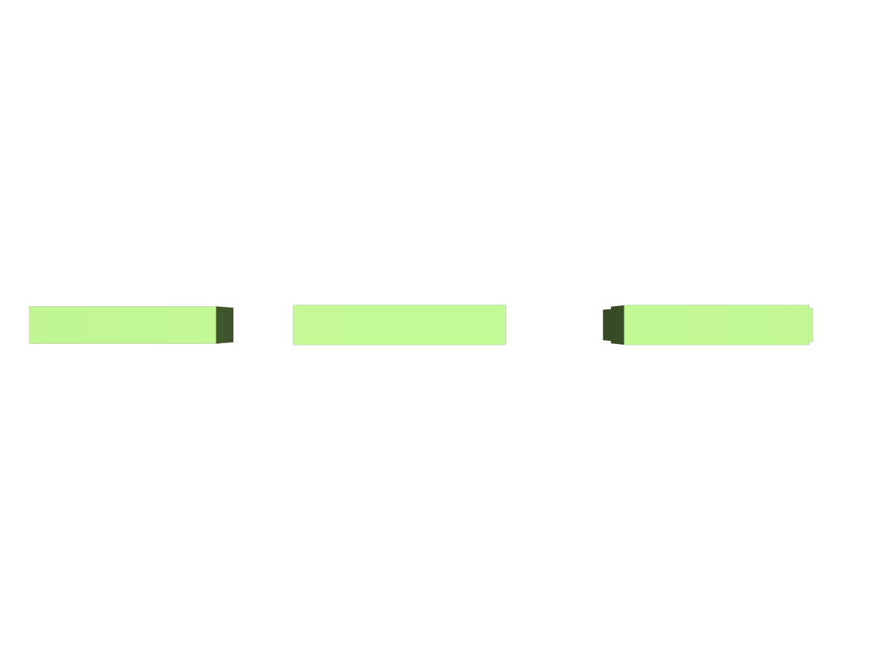

# OpenUSD Runtime Evidence

Validation date: 2026-07-30 on macOS OpenUSD CLI with the Metal Hydra renderer.

## Checks performed

```bash
usdchecker assets/factory_optimized.usda
usdchecker assets/usd/factory.usda
usdcat assets/usd/factory.usda --flatten --out /tmp/factory_flat.usda
usdrecord assets/usd/factory.usda docs/evidence/factory_optimized.png \
  --mask /Factory/Equipment \
  --camera /Factory/Render/FactoryCamera \
  --imageWidth 1200 \
  --renderer Metal
```

Results:

- Legacy downloadable stage: `Success`.
- Modular stage default composition: `Success`.
- `layout:Baseline`: `Success`.
- `layout:Optimized`: `Success`.
- Reference and payload composition flattened successfully.
- Metal Hydra generated a 1200×800 equipment render from the composed stage.



## Runtime boundary

USD Composer / Omniverse Kit is not installed on the validation machine, so the `com.flowforge.factory_inspector` UI extension has been syntax-checked but not launched inside an `omni.*` runtime. This report deliberately distinguishes OpenUSD runtime validation from Omniverse Kit Extension validation.

